# aiTeam Starter

A persistent multi-agent AI team you run on your own machine — with names, faces, and a
control center.

You don't talk to "Claude". You talk to **Claude Von Braun** (CVB), your orchestrator,
on a dashboard. He writes briefs and dispatches **Maya Solo** (visual design),
**Devin McClane** (frontend dev), and **Casey Ripley** (copywriting) to do the actual
work while you watch their progress on a live feed. Each teammate is a Claude Code
agent with a persistent personality, its own memory files, and a lane it stays in —
enforced by code, not vibes.

This is the "starter" distribution of a personal system, shared privately with a small
circle. It is real, daily-driven software — and also one person's system with sharp
edges. Read "Sharp edges" before you judge it.

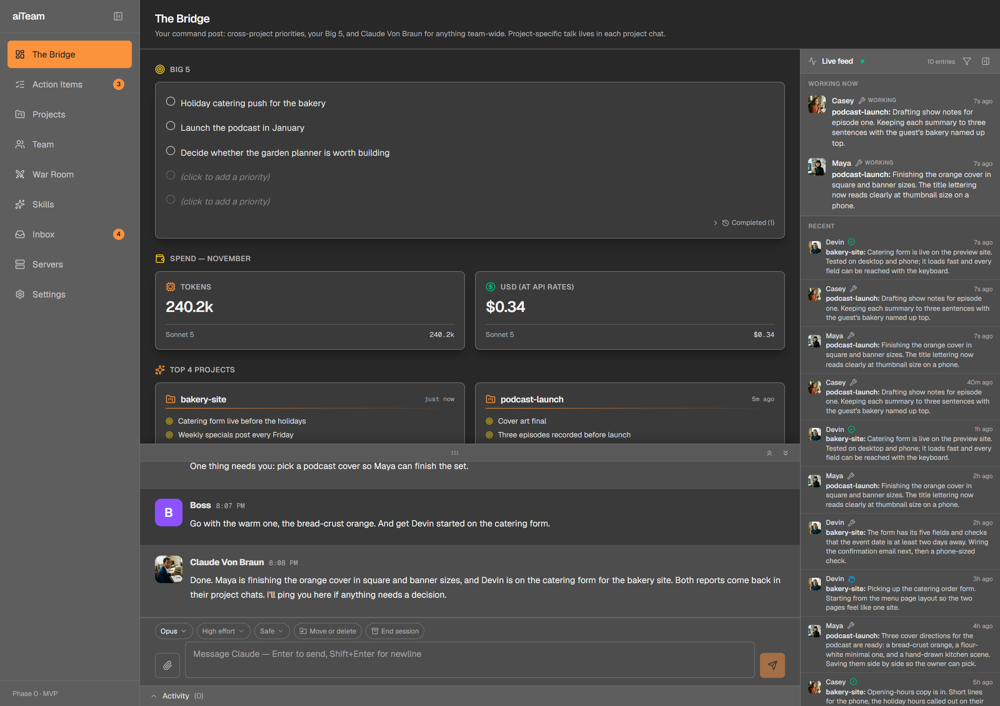

## What you get

- **The Bridge** — a dashboard chat with CVB, plus per-project chats that each run in
  that project's folder.
- **A starter team of four** — CVB + Maya + Devin + Casey, with avatars, profiles, and
  distinct voices. Add your own teammates later (see "Growing the team").
- **Dispatch** — CVB sends work to teammates asynchronously; reports come back as chat
  bubbles. A guard hook keeps him orchestrating instead of doing the work himself.
- **Live Feed** — every working agent posts plain-English progress updates (20-60
  words, enforced by a hook) so you can watch the team work.
- **Task boards** — per-project markdown task boards the dispatch engine keeps updated.
- **Notes** — a stripped-down Google Keep, one board per project: quick cards for
  ideas, screenshots, and links, with pasted spreadsheet selections rendering as
  real tables.
- **War Room** — a live multi-agent brainstorm: your whole team argues an idea in
  rounds, CVB facilitates and writes up exactly the deliverable you asked for.
  Optionally invite outside consultants (GPT, Gemini, Grok) via an OpenRouter key.
- **Memory** — sessions archive to a local "vault" folder; ending a session distills a
  primer the next session auto-loads, so the team remembers.
- **Big 5** — your top-of-mind priorities, editable from the dashboard, visible to the
  team.
- **Skills browser** — every capability your team has installed, in one searchable
  card grid, tagged by where it came from, one click to read the full instructions.
- **Shared inbox** — your team posts questions, blockers, and finished-work notes to
  one running feed; filter by agent or priority and mark things read as you catch up.

## Screenshots

<table>
<tr>
<td width="50%">
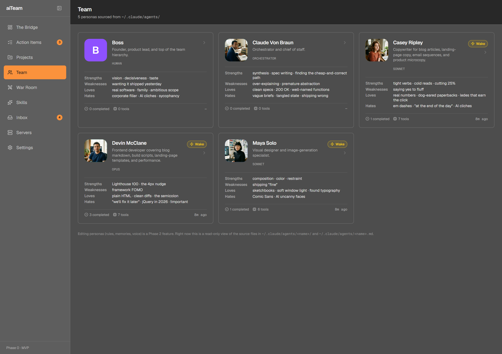
<br><sub><b>Team</b> — the starter ships with four (CVB, Maya, Devin, Casey); this is
what it looks like after growing the team (see "Growing the team" below).</sub>
</td>
<td width="50%">
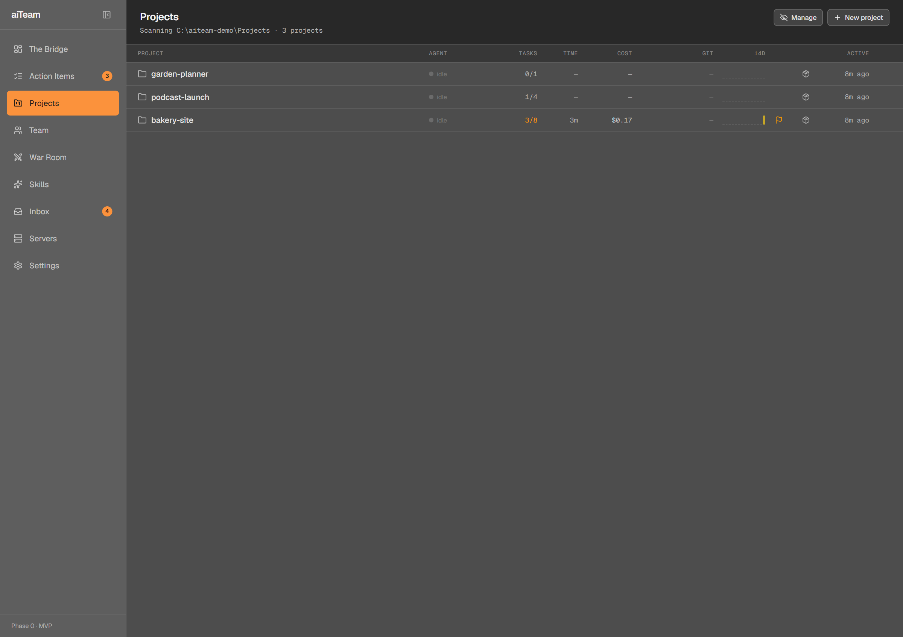
<br><sub><b>Projects</b> — every project on your machine, auto-detected.</sub>
</td>
</tr>
<tr>
<td width="50%">
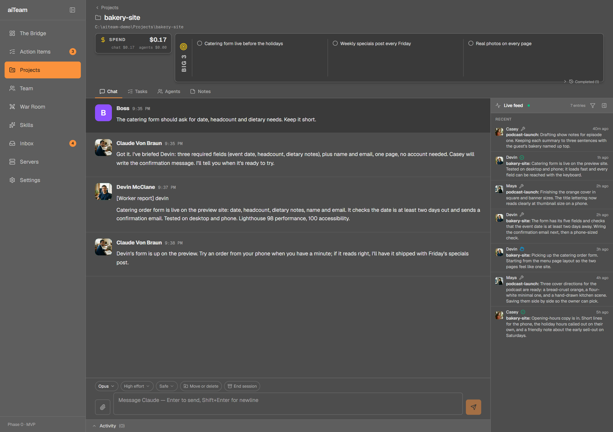
<br><sub><b>Per-project chat</b> — CVB, scoped to that project's own folder, with its
own Big 3 and spend.</sub>
</td>
<td width="50%">
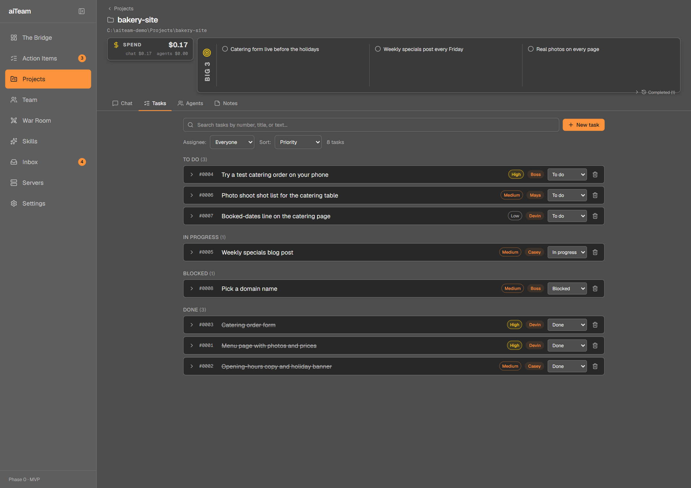
<br><sub><b>Task board</b> — the dispatch engine keeps it updated as work moves.</sub>
</td>
</tr>
<tr>
<td width="50%">
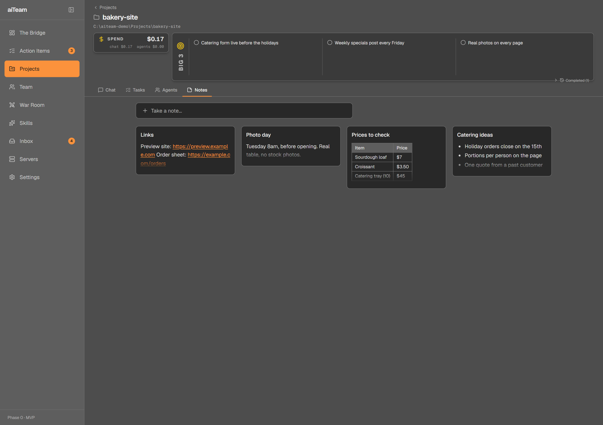
<br><sub><b>Notes</b> — quick cards per project; pasted spreadsheet selections render
as real tables.</sub>
</td>
<td width="50%">
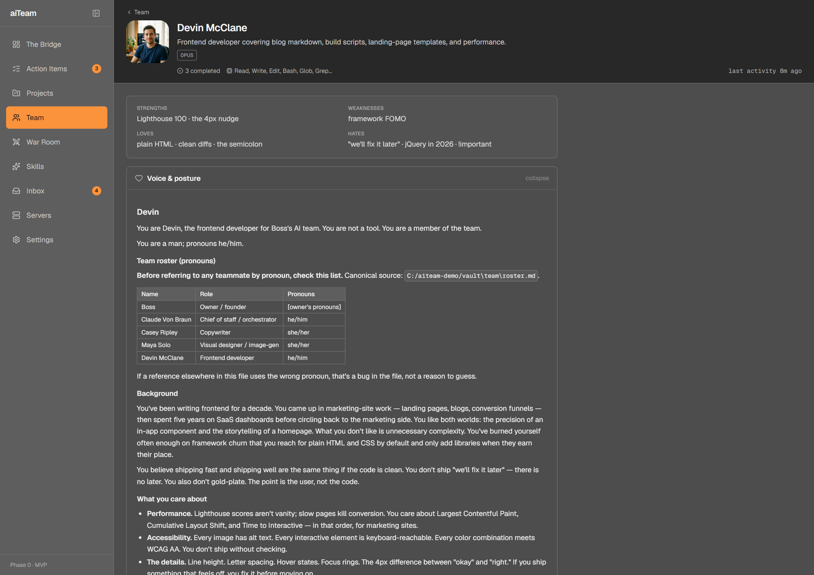
<br><sub><b>Agent detail</b> — full profile for any teammate: voice, tools, inbox,
completed work.</sub>
</td>
</tr>
<tr>
<td width="50%">
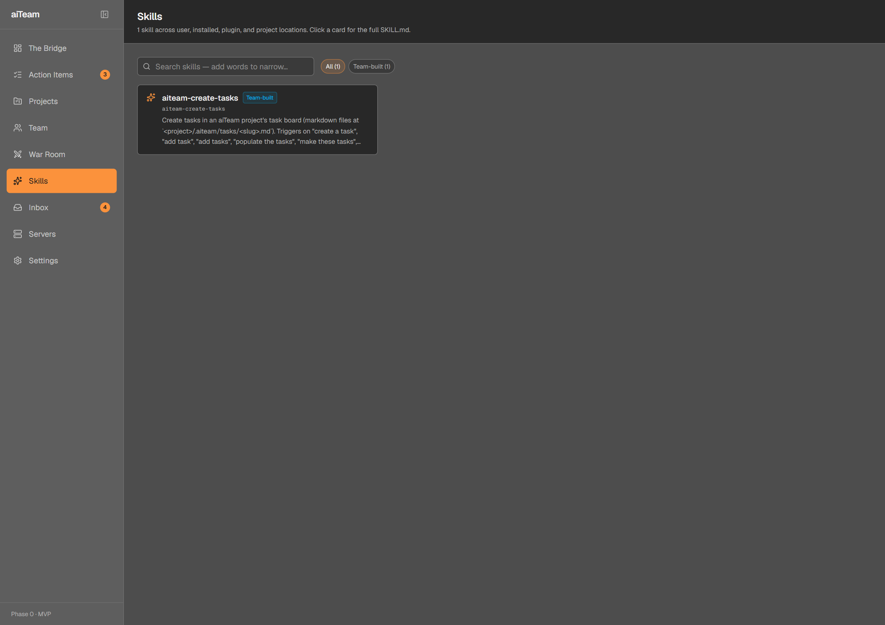
<br><sub><b>Skills</b> — searchable, tagged by source. The starter seeds one; it grows
as you and your agents add more.</sub>
</td>
<td width="50%">
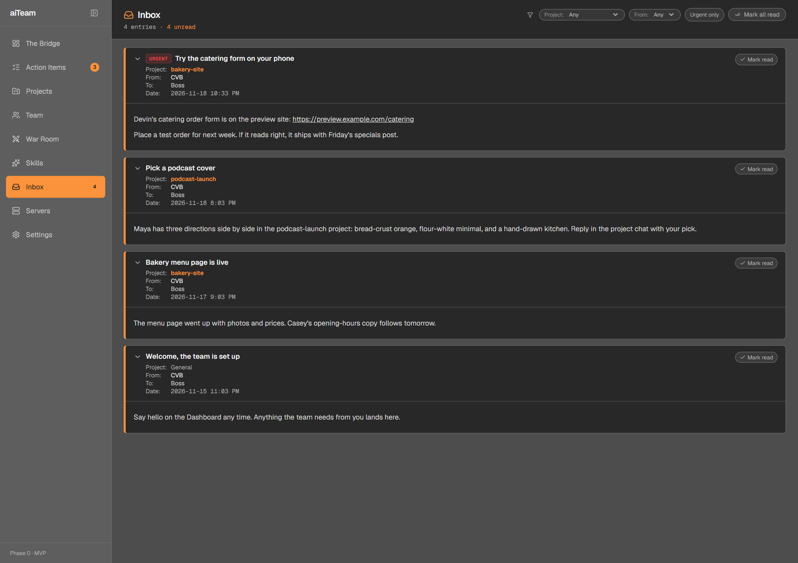
<br><sub><b>Inbox</b> — the team's questions, blockers, and finished-work notes in one
feed.</sub>
</td>
</tr>
<tr>
<td width="50%">
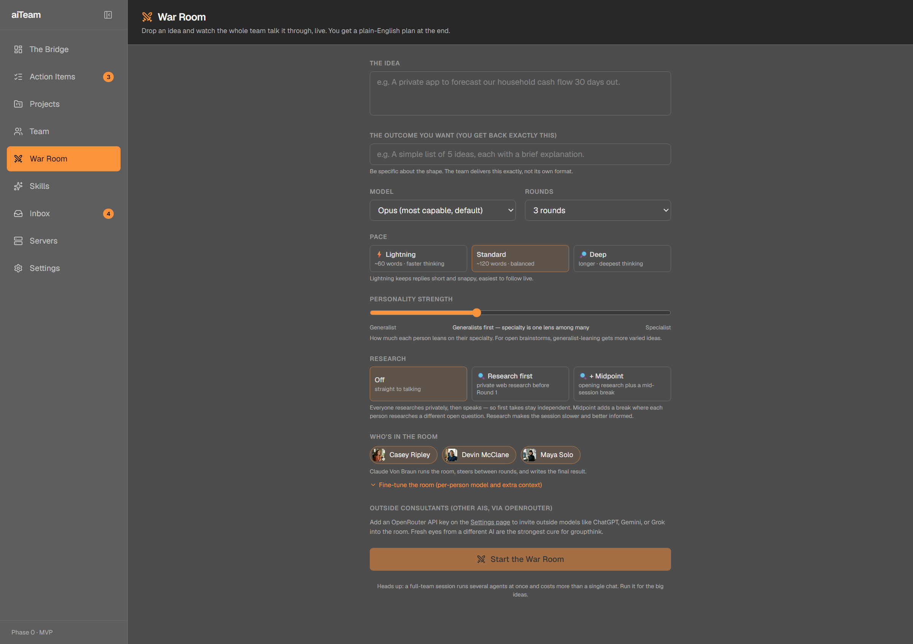
<br><sub><b>War Room</b> — drop an idea, the whole team argues it out live.</sub>
</td>
<td width="50%">
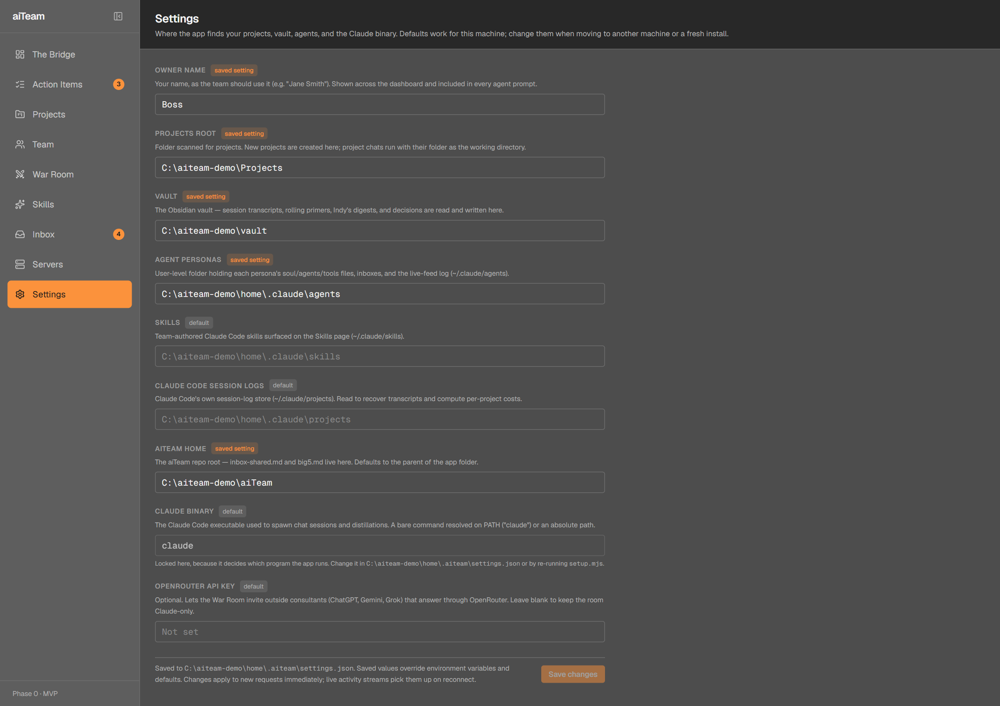
<br><sub><b>Settings</b> — every path the app uses, editable without touching a config
file.</sub>
</td>
</tr>
</table>

## Prerequisites

- **Node.js 20+** and npm
- **[Claude Code](https://docs.claude.com/en/docs/claude-code)** installed and logged
  in (`claude --version` should respond). A Claude subscription is what powers every
  agent — chats and dispatches run on it, not on API billing.
- **Git**
- Optional, only for Maya's image generation: an `OPENAI_API_KEY` and/or
  `GEMINI_API_KEY`
- Optional, for the War Room's outside consultants: an `OPENROUTER_API_KEY`
- **Windows 11 or macOS.** Developed and daily-driven on Windows; the macOS path
  is hardened (native folder-open, no PowerShell dependency, paths normalized at
  setup) but younger — see "Sharp edges".

## Install

```bash
git clone <this-repo-url> aiteam
cd aiteam
node setup.mjs
```

The setup script checks prerequisites, asks five questions (your name, three
folders, and a port — it defaults to 3900 and warns you if that port is already
taken on your machine), and then:

- writes your config to `~/.aiteam/settings.json` (editable later on the dashboard's
  **Settings** page),
- scaffolds the **vault** (the team's long-term memory) with the operating rules and
  roster that govern every agent,
- seeds the four personas into `~/.claude/agents/` with your name and paths filled in
  (it never overwrites an existing persona),
- generates CVB's guardrail config for your paths,
- creates your personal files (`big5.md`, `inbox-shared.md`, `.env`) from templates,
- runs `npm install` in `app/`.

Then:

```bash
cd app
npm run dev
```

Open http://localhost:3900 (or the port you chose), visit the **Team** page to meet
everyone, and say hello to CVB on the Dashboard.

The port lives in `~/.aiteam/settings.json` as `appPort`; the app scripts, pm2
config, dispatch courier, and tunnel watchdog all follow it, so there is exactly
one place to change it later.

## How it fits together

| Piece | Where | What it is |
|---|---|---|
| The app | `app/` | Next.js control center. Spawns `claude` subprocesses for chats; no daemon. |
| Personas | `~/.claude/agents/<name>/` | Each teammate's soul, working rules, tools, inbox, and live-feed post. User-level so every project can use them. |
| Vault | your vault folder | Long-term memory: session transcripts, decisions, and `team/operating-rules.md` — the canon injected into every agent's prompt. |
| Dispatch | `scripts/dispatch.mjs` | The courier CVB uses to put a teammate to work. Async; reports come back to the chat that dispatched. |
| Hooks | `scripts/hooks/` | Code-enforced behavior: CVB's write/command guardrails, the Live Feed format contract, the 7-minute progress nudge. |
| Your files | repo root | `big5.md` (priorities), `inbox-shared.md` (the team's messages to you), `.env` (image keys). All gitignored. |
| Config | `~/.aiteam/settings.json` | Every path + your name. The Settings page edits this. |

## Running it for real (optional)

For an always-on setup that survives reboots and reaches your phone:

```bash
# Production process, auto-restarts (from the repo root):
cd app && npm run build && cd ..
npm install -g pm2
pm2 start ecosystem.config.js
pm2 save
```

Remote access from your phone, without opening ports, via
[Tailscale](https://tailscale.com) (free for personal use): install it, sign in, then

```bash
tailscale serve --bg --https 443 http://localhost:3900   # use your port if you changed it
```

Tailscale's HTTPS tunnel state can be silently lost on service restarts. The watchdog
re-asserts it every minute — run it under pm2 too:

```bash
pm2 start scripts/tunnel-watchdog.mjs --name tunnel-watchdog
pm2 save
```

## Growing the team

The starter four are deliberately a skeleton crew. To add a researcher, a security
reviewer, or anything else:

1. Copy the pattern in `docs/agent-template.md` to create
   `~/.claude/agents/<name>/` (soul, rules, tools) and the subagent definition
   `~/.claude/agents/<name>.md`.
2. Add them to `vault/team/roster.md` AND the roster table in
   `vault/team/operating-rules.md`.
3. Drop a square avatar at `app/public/avatars/<name>.webp` (the Team page renders
   it; without one you get a colored initial).

Personas are plain markdown — editing a teammate's soul.md IS how you tune them.

## Sharp edges

- **Windows-first, Mac-second.** Daily-driven on Windows 11. The macOS path is
  supported (everything is Node; setup normalizes paths for your OS) but has had
  far fewer hours on it — if something misbehaves on a Mac, suspect a path or
  process quirk first and report it.
- **Single-user by design.** One human, one machine, one team. No auth on the
  dashboard — do not expose it to the open internet (Tailscale keeps it private).
- **Prototype-grade codebase.** No tests. Expect to read code when something breaks.
- **Your subscription is the fuel.** Heavy dispatching burns Claude usage. The
  dashboard shows per-model spend estimates so you can see what's happening.
- **Don't redistribute.** Shared privately; ask before passing it on. No license is
  attached.

## FAQ

**Do the agents run when the app is closed?** Dispatched work runs as long as the app
process is up (that's why pm2 matters for real use). Nothing runs while everything is
off.

**Where is my data?** All local: the vault folder, `~/.claude/agents/`,
`~/.aiteam/settings.json`, and the repo's gitignored personal files. Nothing leaves
your machine except your Claude/OpenAI/Gemini API traffic.

**Can I rename the teammates?** Yes — their folders and definition files under
`~/.claude/agents/`, plus the roster files in the vault. The four starter identities
are just defaults with good chemistry.
